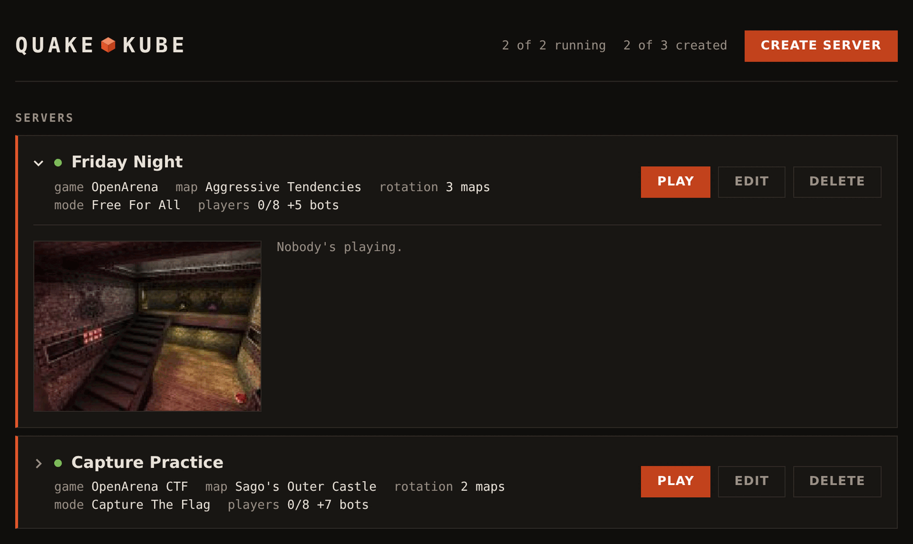
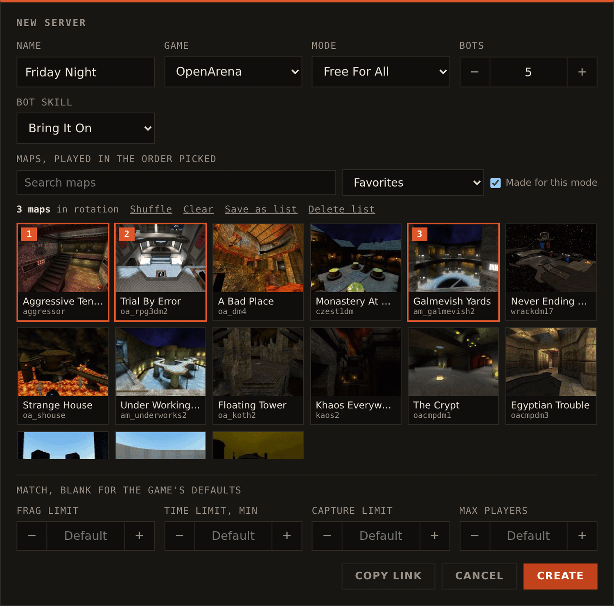
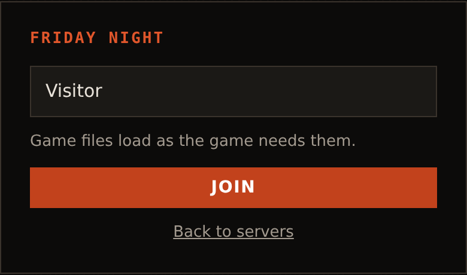
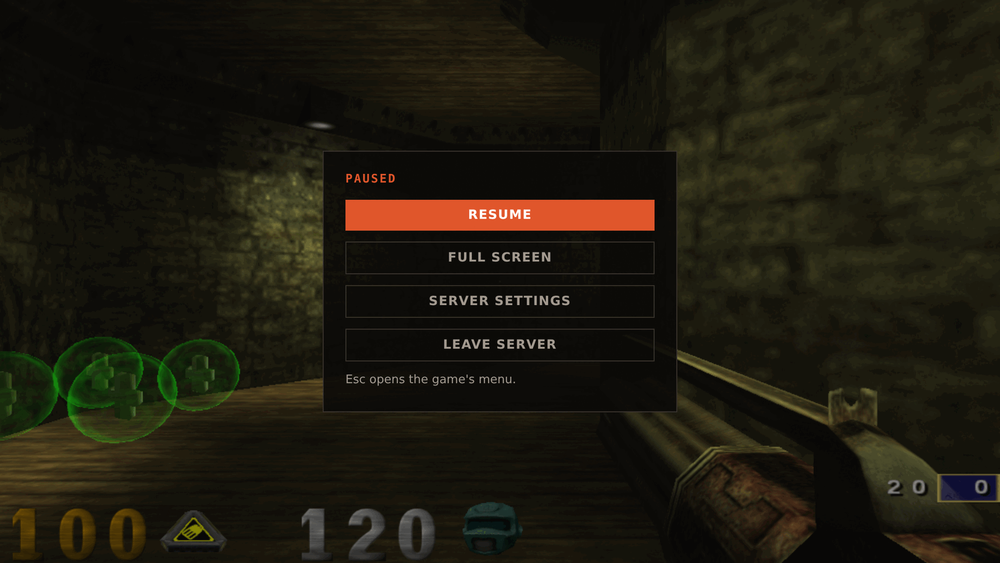

# Using The Web App

The web app lists a cluster's servers, creates them and plays them in the
browser. To reach it, see [Getting Started](getting-started.md). The screenshots
are from the [browser preview](try-it.md), which leaves out a few things a cluster
has, noted below.

## The server list

The list shows every `QuakeServer` in the cluster, including ones created with
`kubectl`. On a cluster, rows also have the server's address for native clients,
whether it needs a password, and its owner when the gateway
[knows who people are](authentication.md).

Clicking a row opens the map's picture, the server's limits and its scoreboard.

While a server starts, its row shows how far along it is. If it's stuck, the row
says why, such as an image that can't be pulled (see
[Troubleshooting](troubleshooting.md#servers-that-dont-start)).

## Creating a server

**Create server** opens this dialog:

- **Name**: up to 64 characters, shown in the list and in server browsers. Servers
  can share a name.
- **Game**: one of the [games](games.md) the gateway offers, each with its own
  modes.
- **Bots**: how many players to fill the server up to, from 0 to 16. They leave as
  people join. Hidden for games without bots.
- **Bot skill**: from I Can Win to Nightmare!
- **Password**: optional, and only on a cluster. Players are asked for it when they
  join.
- **Frag limit**, **Time limit**, **Capture limit**, **Max players**: these apply
  to every map in the rotation.

The button is hidden when `gateway.maxServers` is 0. Creating a server fails
once the limits in `gateway.maxServers` and `gateway.maxServersPerUser` are
reached.

### Picking maps

Servers play their rotation in the order the maps are picked, moving to the next
one after each match. A rotation can have up to 64 maps.

- **Made for this mode** only shows maps whose arena files say they were made for
  the chosen mode.
- The lists menu has the preset's suggested maps and any you've saved.
- **Save as list** keeps the rotation in your browser for that game, and
  **Delete list** removes it.

Pictures and titles of a game's maps take a minute or two to appear the first
time anyone picks from them, since the gateway has to make them.

### Sharing a rotation

**Copy link** copies a link that opens the dialog with the same game, mode and
maps picked. Whoever opens it still chooses a name and creates the server.

## Joining a server

**Play** opens the join page, once the server is ready and has answered the
gateway.

It remembers the player name. On a cluster, it can also ask for:

- the server's password, if it has one
- voice chat, if the server has it, which uses your microphone
- agreement to the Quake 3 demo license, for the game files it downloads, the
  first time

The page says how much joining downloads. Browsers with JSPI, like Chrome and
Edge, load files as the game needs them, and others download paks first (see
[Loading in the browser](add-custom-maps.md#loading-in-the-browser)). Files stay
in your browser's cache, so the next join is faster, including on other servers
running the same game. Browsers only keep that cache on HTTPS pages and on
`localhost`.

## While playing

Clicking **Play** gives the game the mouse. Pressing Esc takes it back and pauses
with a menu, while the game keeps running:

Clicking outside the menu also resumes. **Server settings** is for whoever can
change the server (see below), and **Leave server** goes back to the server list.

## Changing a server

Whoever can manage a server can change it with **Edit** in the list, or
**Server settings** in the pause menu. Its map rotation, mode, bots and limits
apply right away. The map reloads and players stay connected.

Choosing a different game restarts the server, since its pod has to be replaced.
Anyone playing is disconnected until it's back, a minute or so later, and pages
playing the server rejoin it on their own.

## Who can manage a server

**Edit** and **Delete** only appear on servers created from the web app. Servers
created with `kubectl` are managed with `kubectl`.

Without [authentication](authentication.md), anyone who reaches the web app can
manage any server created there. With it, only the server's owner and admins can.

## Idle servers

Servers created from the web app are deleted after nobody has played on them for
`gateway.idleTimeout`, 30 minutes by default. Bots don't count as players. The
list says how long is left once a server is empty, and the time starts over when
someone joins. Servers that never started are deleted the same way.

Servers created with `kubectl` are never deleted for being idle.
